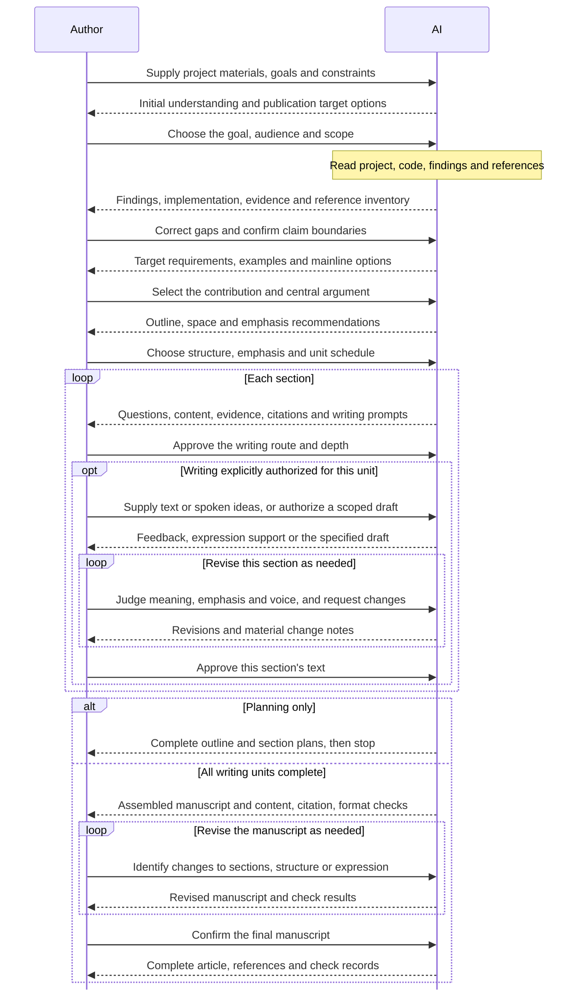

# PaperShaper

*From research to a clear paper, with you in charge.*

[中文说明](README.zh-CN.md) · [MIT license](LICENSE) · [Contributing](CONTRIBUTING.md)

[](https://github.com/SAFuDarren/paper-shaper/actions/workflows/tests.yml)

PaperShaper helps researchers organize evidence, shape the paper's central argument, and develop a manuscript through steps they review and approve. Authors decide what matters, how the argument unfolds, and where to spend the reader's attention. AI prepares the materials and carries out the agreed work, with specialist skills added as needed.

This is an early release of a writing collaboration framework. It starts with planning; it does not automatically draft a complete paper.

## How it works

Each step produces concrete work for author review before continuing. Revise the current delivery when needed; return to the relevant stage if the goal, argument or structure changes.



The writing path shows a section cycle; all section plans can also be completed first. Planning is the default. Writing needs explicit authorization for each unit and support mode. The controller saves progress and decisions; specialist skills join only for the current task.

[See stage inputs, deliveries and operating details in the workflow guide →](docs/workflow.md)

## Install as a skill

Python **3.9+** is required. The controller and tests use only the Python standard library. A host that can read `SKILL.md` and run local Python commands is needed to use it as an agent skill.

For Codex, clone this repository into the skills directory:

```sh
mkdir -p "${CODEX_HOME:-$HOME/.codex}/skills"
git clone https://github.com/SAFuDarren/paper-shaper.git \
  "${CODEX_HOME:-$HOME/.codex}/skills/paper-shaper"
```

Then, in your research project, ask:

> Use $paper-shaper to read this project and prepare the current planning task. Keep the manuscript in planning mode and wait for my review.

For another compatible host, place the complete repository in its skill location. Keep `scripts/`, `config/`, and `agents/` alongside `SKILL.md`; copying the entry file alone is not enough. Task contracts are currently written in Chinese; CLI messages and the example below are in English. Tell your host which language to use for discussion and writing.

## Try the controller

These commands work from the repository root as a smoke check. For real work, use a project-appropriate work directory and pass that project's root.

```sh
python3 scripts/framework.py init ./paper-work --project-root .
python3 scripts/framework.py status ./paper-work
python3 scripts/framework.py packet ./paper-work
python3 scripts/framework.py start ./paper-work
python3 scripts/framework.py form ./paper-work
```

The AI completes the task and saves a result manifest matching `form`. An explicitly fictional example is provided in [examples/](examples/).

```sh
python3 scripts/framework.py submit ./paper-work --result ./paper-work/result.json
```

Submission checks required output roles, concrete files, a self-check record, and human decision fields. It freezes copies of the delivery and waits for review. It does **not** approve its own work.

After a real, unambiguous author approval, record the actual message reference and quotation with `review`. Where several options exist, a selection file must identify the chosen option. Run the command help for exact arguments:

```sh
python3 scripts/framework.py review --help
python3 scripts/framework.py help
```

The CLI records the approval supplied to it. It cannot authenticate who supplied that record.

## Keep context focused

- The short skill entry delegates process rules to the controller.
- `packet` includes the current stage, relevant approved summaries and decisions, selected material excerpts, and current capabilities.
- The default packet limit is **8,000 characters**, not tokens. Required content exceeding the limit causes an explicit error; optional omissions are reported.
- `attach` selects source files and line ranges. `detach` removes an excerpt while retaining its source hash.
- `request` produces a smaller handoff for one capability, selected materials, and one output. It does not call a model, run a skill, or create a fresh agent context.

For example, ask a paper-reading skill to produce one reference card, save the result, and repeat for another paper before preparing a comparison for the author. Do not load every paper and every skill at once.

## Add or replace skills

The framework works with ordinary available tools and does not require a bundled academic suite. Optional capabilities include literature search, paper reading, citation verification, argument planning, writing, figures, review, and document output.

```sh
python3 scripts/framework.py discover ./paper-work --capability paper-reading
python3 scripts/framework.py bind ./paper-work \
  --capability paper-reading \
  --entry /absolute/path/to/selected-skill/SKILL.md \
  --hint "Analyze only the requested paper and return a reference card."
```

Bind before starting the task. A custom capability can be attached to a stage with `--stage`, such as `R06`. Skill discovery covers common local directories and plugin caches; it can also use additional search roots or a direct entry path. The framework does not install skills automatically.

Providers are optional, replaceable, and not vendored here. Their licenses and instructions still apply. A provider handles its scoped content task; its self-review does not count as the author's approval. Binding metadata is not a guarantee that every external skill has been tested for semantic compatibility.

## State, versions, and boundaries

Work is saved in a project work directory. The controller keeps a state index, review records, frozen delivery copies, and registered source hashes. `reopen` marks affected tasks and their dependents for review; it does not silently refresh old approvals. Provider versions are frozen when a task starts. A change during the task requires reopening and rebinding.

The controller validates records and workflow constraints. It does not prove scientific claims, verify that an AI actually read a source, authenticate human messages, clear the host's existing context, or enforce a permission sandbox around another skill. Only registered dependencies can be checked for changes. Posting, submission, and external communication remain separate actions requiring the author's authorization.

## Development

```sh
python3 -m unittest discover -s tests -v
```

The current version includes 49 tests covering the state controller, real CLI transitions, review gates, context limits, frozen versions, optional capability bindings, scoped requests, and Unicode paths/output. Test approval messages are synthetic fixtures, never real authorizations.

Runtime files and research materials belong outside the public source tree. See [CONTRIBUTING.md](CONTRIBUTING.md) before sharing a reproduction.

## License

[MIT](LICENSE). Optional third-party skills are distributed separately under their own terms.
