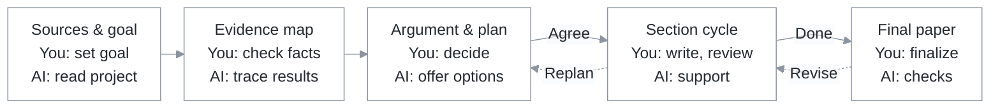

# PaperShaper

*From research to a clear paper, with you in charge.*

[中文说明](README.zh-CN.md) · [MIT license](LICENSE) · [Contributing](CONTRIBUTING.md)

[](https://github.com/SAFuDarren/paper-shaper/actions/workflows/tests.yml)

PaperShaper turns research files into an evidence-backed argument and a section-by-section writing plan. AI traces findings, implementation details and references, reconstructs the reasoning, and offers ways to organize the paper. You decide the contribution, structure, emphasis and final expression. Each round saves concrete work and your decisions, giving the next step a clear starting point.

Start with a paper plan, then choose how to develop each section. Add specialist skills for search, citation checks, figures or review when you need them.

## How it works

Sources and goal → Evidence map → Argument and outline → Section cycle → Final review. AI prepares the work; you check it, choose a direction and confirm the next step.



Review each delivery, carry your decisions forward, and return to the relevant step for revisions. Start with the argument and outline, then choose support for each unit: feedback on your own writing, expression support, or an AI draft you authorize.

[See stage inputs, deliveries and operating details in the workflow guide →](docs/workflow.md)

## Understand a complex project

Before proposing a paper, R02 produces a project brief, result/evidence map and
research reasoning chain. A standard-library tool follows selected source entries,
indexes result candidates and checks that each has a recorded disposition. Claims
keep their conditions, source lines and evidence status; links explain the premises,
conclusion and any missing bridge. R04 recommendations point to those exact records.
The research dependency chain and the paper's presentation order remain separate.

The tool checks source versions, candidate coverage, references between records,
derivation cycles and declared gaps. AI interprets the content; the author assesses
the findings and chooses the paper's argument. See
[the task-specific record contract](references/research-records.md).

New work directories enable these structured checks by default. Existing directories
keep their recorded contract and review history. To try the updated contract, use
a new diagnostic directory and bring its recommendations to the author for review.

## Install as a skill

Python **3.9+** is required; prefer a maintained release. The controller and tests use only the Python standard library. A host that can read `SKILL.md` and run local Python commands is needed. The CI matrix covers CPython 3.11–3.15 on Linux, Windows and macOS, plus Linux compatibility checks for CPython 3.9/3.10 and PyPy 3.11. See [environment setup and coverage](docs/environment.md).

For Codex, clone this repository into the skills directory:

```sh
mkdir -p "${CODEX_HOME:-$HOME/.codex}/skills"
git clone https://github.com/SAFuDarren/paper-shaper.git \
  "${CODEX_HOME:-$HOME/.codex}/skills/paper-shaper"
```

On Windows PowerShell:

```powershell
$paperSkillRoot = if ($env:CODEX_HOME) { Join-Path $env:CODEX_HOME "skills" } else { Join-Path $HOME ".codex\skills" }
New-Item -ItemType Directory -Force -Path $paperSkillRoot | Out-Null
git clone https://github.com/SAFuDarren/paper-shaper.git (Join-Path $paperSkillRoot "paper-shaper")
py -3 (Join-Path $paperSkillRoot "paper-shaper\scripts\framework.py") doctor
```

Use `python` in an activated environment; use `py -3` or `python` on Windows, and usually `python3` on macOS/Linux. Run `doctor` when first installing or changing interpreters. The commands below use `python3` as the POSIX example.

Then, in your research project, ask:

> Use $paper-shaper to read this project and prepare the current planning task. Keep the manuscript in planning mode and wait for my review.

For another compatible host, place the complete repository in its skill location, with `scripts/`, `config/`, `references/`, and `agents/` alongside `SKILL.md`. Task contracts are currently written in Chinese; CLI messages and the example below are in English. Tell your host which language to use for discussion and writing.

## Try the controller

These commands work from the repository root as a smoke check. For real work, use a project-appropriate work directory and pass that project's root.

```sh
python3 scripts/framework.py doctor
python3 scripts/framework.py init ./paper-work --project-root .
python3 scripts/framework.py status ./paper-work
python3 scripts/framework.py packet ./paper-work
python3 scripts/framework.py start ./paper-work
python3 scripts/framework.py form ./paper-work
```

The AI completes the task and saves a result manifest matching `form`. An explicitly fictional example is provided in [examples/](examples/).

```sh
python3 scripts/framework.py submit ./paper-work --result ./paper-work/result.json
```

Submission checks required output roles, files, self-checks and decisions to make. It freezes the delivery and prepares it for your review.

After a real, unambiguous author approval, record the actual message reference and quotation with `review`. Where several options exist, a selection file must identify the chosen option. Run the command help for exact arguments:

```sh
python3 scripts/framework.py review --help
python3 scripts/framework.py help
```

The review record preserves the author's quoted decision and the delivery version it applies to.

## Keep context focused

- The short skill entry delegates process rules to the controller.
- `packet` includes the current stage, relevant approved summaries and decisions, selected material excerpts, and current capabilities.
- The default packet limit is **8,000 characters**, not tokens. Required content exceeding the limit causes an explicit error; optional omissions are reported.
- `attach` selects source files and line ranges. `detach` removes an excerpt while retaining its source hash.
- `request` prepares a small handoff for one capability, selected materials and one output; the host carries out that task.

For example, ask a paper-reading skill for one reference card, save it, then process the next paper. Use those cards to prepare a compact comparison for the author.

## Add or replace skills

Start with the tools available in your host. Add capabilities for literature search, paper reading, citation verification, argument planning, writing, figures, review or document output as needed.

```sh
python3 scripts/framework.py discover ./paper-work --capability paper-reading
python3 scripts/framework.py bind ./paper-work \
  --capability paper-reading \
  --entry /absolute/path/to/selected-skill/SKILL.md \
  --hint "Analyze only the requested paper and return a reference card."
```

Bind before starting the task. A custom capability can be attached to a stage with `--stage`, such as `R06`. Skill discovery covers common local directories and plugin caches; it can also use additional search roots or a direct entry path. You choose which skills to install.

Providers are optional and replaceable, with their own licenses and instructions. Give each one a defined task and bring its result into the same author review. See [validation notes](docs/validation.md) for the scope of provider checks.

## Progress and review

A project work directory keeps progress, review records, frozen deliveries and registered source versions. Use `reopen` when inputs or decisions change; affected work returns for review while earlier records remain available. After revising R05 or an upstream decision, approve the new architecture and authorize its writing units. Retire moved or removed inputs explicitly, then register their replacements. Provider entry-file versions are frozen when work starts; reopen and rebind to adopt a changed entry.

The controller maintains registered records, versions and workflow order. AI provides analysis; the author reviews the research and expression. The host manages the model and session context, and the author decides when to publish or submit. See [validation notes](docs/validation.md) for the exact checks.

## Development

```sh
python3 -m unittest discover -s tests -v
```

The current version includes 94 tests covering the state controller, real CLI transitions, review gates, context limits, frozen versions, optional capability bindings, scoped requests, and Unicode paths/output. Approval records in the tests use fictional examples.

Tests also cover authorization revocation, missing-input recovery, schedule integrity, BOM files, environment diagnosis and bounded-memory file access. Every CI configuration runs a fresh environment without pip. See the [requirements and validation notes](docs/validation.md).

Runtime files and research materials belong outside the public source tree. See [CONTRIBUTING.md](CONTRIBUTING.md) before sharing a reproduction.

## License

[MIT](LICENSE). Optional third-party skills are distributed separately under their own terms.
