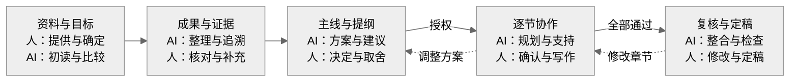

# PaperShaper

*From research to a clear paper, with you in charge.*

**把研究成果组织成清晰的论文，关键取舍由你决定。**

[English](README.md) · [MIT 许可证](LICENSE)

PaperShaper 是一个可组合的论文协作框架，从项目材料、研究成果和参考文献出发，帮助作者理清贡献与论证，规划适配投稿目标的结构，并逐节推进写作。作者决定主线、详略和关键表达，AI 负责材料准备、分析和执行。每轮交付具体成果，经作者复核后继续；检索、引用核查、绘图和审稿能力可以按需接入。

这是早期公开版本。默认只做规划，完成提纲不会自动开始整篇正文。

## 如何协作

每一步都先交付具体成果，由人复核同意后继续。需要修改时，先修改当前交付；涉及目标、主线或结构的变化，回到对应阶段。



每一步都先交人复核，确认后继续；需要修改就回到对应步骤。默认只交付提纲与逐节写作方案。图中写作路径需要逐节授权：作者可自己写，也可选择 AI 反馈、表达支持或指定草稿。

[每轮输入、交付与具体操作见协同指南 →](docs/workflow.zh-CN.md)

## 理解复杂项目

前期先交付项目理解、成果与证据表、研究推理链，再提出文章主线。标准库程序从选定入口追踪文件、定位成果候选，并检查每个候选是否已映射、合并、排除或保留为待核项。AI 逐项解释成果条件、证据状态和推理依据；主线建议绑定具体成果与推理步骤，研究依赖关系与文章呈现顺序分开处理。

程序核对来源版本、行号、候选去向、悬空引用、推导循环和已声明的推理缺口；AI 判断内容，人复核理解并选主线。“已记录去向”不等于“已证明”，也不等于“应写入正文”。[这一轮的记录契约](references/research-records.md)仅在需要时加载。

新工作目录默认启用这些检查；旧目录保留既有契约和批准记录。需要新诊断时另建目录，不静默改写历史。跨阶段诊断可先准备待复核建议，不伪造批准、不推进写作状态。

## 安装与使用

需要 Python 3.9+，建议使用仍在维护的版本。运行时和测试均只使用标准库。CI 覆盖 Linux、Windows、macOS 上的 CPython 3.11–3.15，并检查 Linux 上的 CPython 3.9/3.10 和 PyPy 3.11。宿主需要能读取 `SKILL.md` 并执行本地 Python。[环境选择、覆盖范围与恢复说明](docs/environment.md)。

Codex 用户可以安装到 skills 目录：

```sh
mkdir -p "${CODEX_HOME:-$HOME/.codex}/skills"
git clone https://github.com/SAFuDarren/paper-shaper.git \
  "${CODEX_HOME:-$HOME/.codex}/skills/paper-shaper"
```

Windows PowerShell 安装方式：

```powershell
$paperSkillRoot = if ($env:CODEX_HOME) { Join-Path $env:CODEX_HOME "skills" } else { Join-Path $HOME ".codex\skills" }
New-Item -ItemType Directory -Force -Path $paperSkillRoot | Out-Null
git clone https://github.com/SAFuDarren/paper-shaper.git (Join-Path $paperSkillRoot "paper-shaper")
py -3 (Join-Path $paperSkillRoot "paper-shaper\scripts\framework.py") doctor
```

选择实际使用的解释器：虚拟环境用 `python`，Windows 常用 `py -3` 或 `python`，macOS/Linux 常用 `python3`。首次安装或切换环境先运行 `doctor`；不需要额外安装包。

然后在研究项目中说：

> 使用 $paper-shaper 读取这个项目，恢复已确认的决定，只完成当前一轮交付。先规划，不写正文，交我复核后再继续。

其他兼容宿主可将完整仓库放到对应位置；不要只复制 `SKILL.md`。`scripts/`、`config/`、`references/` 和 `agents/` 需要保留。

完整命令和示例见[英文说明](README.md)。程序的常用动作包括初始化、恢复进度、生成任务包、登记材料、提交、人审、重新打开任务以及绑定可选 skill。

## 小上下文与能力组合

- 常驻入口保持精简。八轮契约由程序读取，每次只给当前轮。
- 已确认成果用简短摘要、具体选择和文件指针继承；需要原文时显式选取片段。
- 默认任务包上限为 8,000 字符。必需内容超限时报错，可选内容省略时列出。
- `request` 可以为单个能力、选定材料和一个输出生成小请求，例如一次只分析一篇论文并保存参考卡。
- 外接 skill 可发现、绑定和替换，也可增加指定阶段的领域能力。框架不会自动安装或执行完整学术管线。

任务包上限不能清空宿主已有的上下文；大型外部 skill 的必读入口仍需要合理控制。小请求本身也不会自动创建隔离会话。

## 版本与复核

交付时程序检查文件、必交付角色、自查记录和人的选择字段，冻结副本并等待复核。多个候选尚未选定时不能代选。材料或已批版本发生变化后，按影响范围重新打开任务，旧记录保留。重开 R05 或其上游会退役旧写作节点并撤销旧授权，即使章节 ID 相同也需要在新架构确认后重新授权。文件移动或移除可在重开后用 `retire-input` 明确退役旧输入，保留历史哈希，再登记替代文件。

程序检查记录与流程约束，不认证人的身份或学术结论正确性，也不能证明 AI 实际完成了阅读。只有登记过的输入变化才能追踪。真实内容仍需核查，最终判断由作者承担。

## 测试与贡献

```sh
python3 -m unittest discover -s tests -v
```

当前版本包含 94 项测试，覆盖流程约束及中文路径/输出兼容性。补充覆盖授权失效、缺文件恢复、处理顺序一致性、BOM、环境诊断和大文件内存边界。每个 CI 环境另运行无 pip 的独立虚拟环境检查。测试中的批准消息均是合成示例，不是真实授权。[需求映射与验证记录](docs/validation.md)。欢迎用最小化的虚构材料报告问题；请勿提交论文原稿、私有结果、个人路径、凭据或真实运行状态。详见[贡献说明](CONTRIBUTING.md)。

## 许可证

本框架采用 [MIT](LICENSE)。可选第三方 skill 单独安装，遵守各自许可证。
