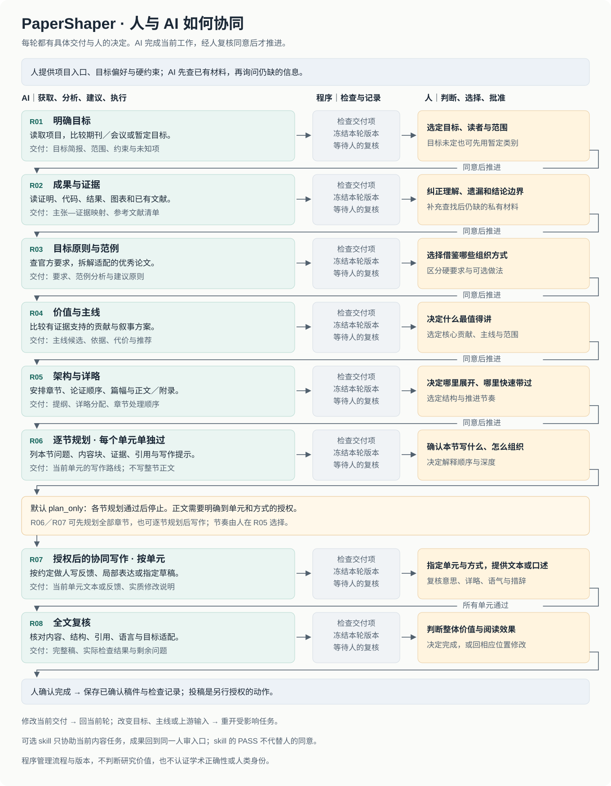

# PaperShaper

*From research to a clear paper, with you in charge.*

**把研究成果组织成清晰的论文，关键取舍由你决定。**

[English](README.md) · [MIT 许可证](LICENSE)

PaperShaper 是一个可组合的论文协作框架，从项目材料、研究成果和参考文献出发，帮助作者理清贡献与论证，规划适配投稿目标的结构，并逐节推进写作。作者决定主线、详略和关键表达，AI 负责材料准备、分析和执行。每轮交付具体成果，经作者复核后继续；检索、引用核查、绘图和审稿能力可以按需接入。

这是早期公开版本。默认只做规划，完成提纲不会自动开始整篇正文。

## 三方分工

| 负责方 | 工作 |
| --- | --- |
| 人 | 判断目标、价值、主线、结构、详略和最终表达，逐轮复核。 |
| AI／专业 skill | 获取材料、分析与核查内容、比较方案、执行已定任务。 |
| 程序 | 管理当前任务、必交付项、具体选择、人审记录、交付版本、依赖失效和任务包大小。 |

## 完整协同流程

**每一轮都有具体交付，以及必须由人作出的判断。** AI 准备依据、比较方案并执行；人决定目标、价值、结构、详略和最终表达；程序检查并记录交接，收到人的明确同意后才允许推进。



[每轮输入、交付与人的决定 →](docs/workflow.zh-CN.md#每轮的输入交付与人的决定) · [人审、修改与回退循环 →](docs/workflow.zh-CN.md#每一轮都经过同一个交接循环) · [一部分一部分地推进 →](docs/workflow.zh-CN.md#一部分一部分地推进)

R01–R05 依次确定目标、证据、目标原则、主线和架构；R06 逐节规划。默认 `plan_only` 在所有章节规划通过后停止。R07 需要明确到单元和支持方式的写作授权；R08 交付完整稿及实际检查结果，由人决定完成或修改。

R05 可以选择**全部先规划**，或**逐节循环**（当前节规划 → 人审 → 授权后的协同写作 → 人审 → 下一节）。每个单元单独复核，“八轮”不是固定八次对话。当前交付需要修改就留在当前轮；上游取舍变更则重开受影响任务。外接 skill 的成果进入同一人审流程，其 PASS 不代替人的同意。

## 安装与使用

需要 Python 3.9+，运行时和测试均只使用标准库。宿主需要能读取 `SKILL.md` 并执行本地 Python。

Codex 用户可以安装到 skills 目录：

```sh
mkdir -p "${CODEX_HOME:-$HOME/.codex}/skills"
git clone https://github.com/SAFuDarren/paper-shaper.git \
  "${CODEX_HOME:-$HOME/.codex}/skills/paper-shaper"
```

然后在研究项目中说：

> 使用 $paper-shaper 读取这个项目，恢复已确认的决定，只完成当前一轮交付。先规划，不写正文，交我复核后再继续。

其他兼容宿主可将完整仓库放到对应位置；不要只复制 `SKILL.md`。`scripts/`、`config/` 和 `agents/` 需要保留。

完整命令和示例见[英文说明](README.md)。程序的常用动作包括初始化、恢复进度、生成任务包、登记材料、提交、人审、重新打开任务以及绑定可选 skill。

## 小上下文与能力组合

- 常驻入口保持精简。八轮契约由程序读取，每次只给当前轮。
- 已确认成果用简短摘要、具体选择和文件指针继承；需要原文时显式选取片段。
- 默认任务包上限为 8,000 字符。必需内容超限时报错，可选内容省略时列出。
- `request` 可以为单个能力、选定材料和一个输出生成小请求，例如一次只分析一篇论文并保存参考卡。
- 外接 skill 可发现、绑定和替换，也可增加指定阶段的领域能力。框架不会自动安装或执行完整学术管线。

任务包上限不能清空宿主已有的上下文；大型外部 skill 的必读入口仍需要合理控制。小请求本身也不会自动创建隔离会话。

## 版本与复核

交付时程序检查文件、必交付角色、自查记录和人的选择字段，冻结副本并等待复核。多个候选尚未选定时不能代选。材料或已批版本发生变化后，按影响范围重新打开任务，旧记录保留。

程序检查记录与流程约束，不认证人的身份或学术结论正确性，也不能证明 AI 实际完成了阅读。只有登记过的输入变化才能追踪。真实内容仍需核查，最终判断由作者承担。

## 测试与贡献

```sh
python3 -m unittest discover -s tests -v
```

当前版本包含 49 项测试，覆盖流程约束及中文路径/输出兼容性。测试中的批准消息均是合成示例，不是真实授权。欢迎用最小化的虚构材料报告问题；请勿提交论文原稿、私有结果、个人路径、凭据或真实运行状态。详见[贡献说明](CONTRIBUTING.md)。

## 许可证

本框架采用 [MIT](LICENSE)。可选第三方 skill 单独安装，遵守各自许可证。
