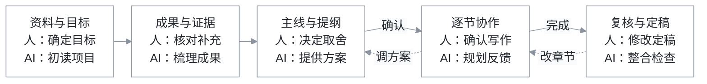

# PaperShaper

*From research to a clear paper, with you in charge.*

**把研究成果组织成清晰的论文，关键取舍由你决定。**

[English](README.md) · [MIT 许可证](LICENSE)

PaperShaper 把项目资料整理成有依据的论文主线和逐节写作方案。AI 梳理成果、实现与文献，追踪证据和推理关系，提出可比较的组织建议；作者决定贡献、结构、详略与最终表达。每轮留下具体成果和已定选择，让后续协作沿着同一条思路推进。

从论文规划开始，再逐节选择写作方式。需要检索、引用核查、绘图或审稿时，接入对应的专业 skill。

## 如何协作

资料与目标 → 成果与证据 → 主线与提纲 → 逐节协作 → 复核与定稿。AI 准备材料与方案，作者核对、选择并确认下一步。



每轮交付经作者复核后推进，修改意见带回对应步骤。从主线与提纲开始，再由作者逐节选择：自己写并获取反馈、获得表达支持，或授权 AI 起草指定内容。

[每轮输入、交付与具体操作见协同指南 →](docs/workflow.zh-CN.md)

## 理解复杂项目

前期先交付项目理解、成果与证据表、研究推理链及价值分析。AI 可以推荐；作者明确选定重点后，再比较文章主线。标准库程序从选定入口追踪文件、定位成果候选，并检查每个候选是否已映射、合并、排除或保留为待核项。AI 逐项解释成果条件、证据状态和推理依据；主线建议绑定具体成果与推理步骤，研究依赖关系与文章呈现顺序分开处理。

成果保留适用条件、来源位置与证据状态，推理记录写明前提、结论和待补桥梁。每项价值分析分开已有基线、实际增量、可能价值及范围成本；后续每轮和外接 skill 请求继承选中成果的具体内容、作者给出的理由和确认版本。程序核对版本、候选覆盖与关系一致性；AI 解释内容，作者判断成果价值并选择主线。[这一轮的记录契约](references/research-records.md)按需加载。

新工作目录默认启用这些检查。已有目录保留记录的契约与复核历史；要采用新版契约做诊断，可另建目录，将结果作为待复核建议。

## 安装与使用

需要 Python 3.9+，建议使用仍在维护的版本。运行时和测试均只使用标准库。CI 覆盖 Linux、Windows、macOS 上的 CPython 3.11–3.15，并检查 Linux 上的 CPython 3.9/3.10 和 PyPy 3.11。宿主需要能读取 `SKILL.md` 并执行本地 Python。[环境选择、覆盖范围与恢复说明](docs/environment.md)。

Codex 用户可以安装到 skills 目录：

```sh
mkdir -p "${CODEX_HOME:-$HOME/.codex}/skills"
git clone https://github.com/SAFuDarren/paper-shaper.git \
  "${CODEX_HOME:-$HOME/.codex}/skills/paper-shaper"
```

Windows PowerShell 安装方式：

```powershell
$paperSkillRoot = if ($env:CODEX_HOME) { Join-Path $env:CODEX_HOME "skills" } else { Join-Path $HOME ".codex\skills" }
New-Item -ItemType Directory -Force -Path $paperSkillRoot | Out-Null
git clone https://github.com/SAFuDarren/paper-shaper.git (Join-Path $paperSkillRoot "paper-shaper")
py -3 (Join-Path $paperSkillRoot "paper-shaper\scripts\framework.py") doctor
```

选择实际使用的解释器：虚拟环境用 `python`，Windows 常用 `py -3` 或 `python`，macOS/Linux 常用 `python3`。首次安装或切换环境先运行 `doctor`；不需要额外安装包。

然后在研究项目中说：

> 使用 $paper-shaper 读取这个项目，恢复已确认的决定，只完成当前一轮交付。先规划，不写正文，交我复核后再继续。

其他兼容宿主可将完整仓库放到对应位置，保留 `SKILL.md`、`scripts/`、`config/`、`references/` 和 `agents/`。

完整命令和示例见[英文说明](README.md)。程序的常用动作包括初始化、恢复进度、生成任务包、登记材料、提交、人审、重新打开任务以及绑定可选 skill。

## 小上下文与能力组合

- 常驻入口保持精简。八轮契约由程序读取，每次只给当前轮。
- 已确认成果用简短摘要、具体选择和文件指针继承；需要原文时显式选取片段。
- 默认任务包上限为 8,000 字符。必需内容超限时报错，可选内容省略时列出。
- `request` 可以为单个能力、选定材料和一个输出生成小请求，例如一次只分析一篇论文并保存参考卡。
- 外接 skill 可发现、绑定和替换，也可增加指定阶段的领域能力；每次处理一个明确任务，安装由用户选择。

任务包控制本轮交给 AI 的材料量；会话上下文由宿主管理。选择外部 skill 时，也应考虑其必读入口的大小。

## 进度与复核

交付时程序核对必需文件、自查记录和待选事项，冻结版本并生成复核包。作者的选择与对应版本一起保存；材料或已定方案变化时，按影响范围重新打开任务。修改 R05 或其上游后，在新架构确认时重新选择写作单元与授权方式。移动或移除的材料可用 `retire-input` 留存历史，再登记替代文件。

程序维护已登记输入、版本和流程记录；AI 提供分析，作者复核内容并作出研究与表达上的判断。具体检查范围见[验证说明](docs/validation.md)。

## 测试与贡献

```sh
python3 -m unittest discover -s tests -v
```

当前版本包含 105 项测试，覆盖流程约束及中文路径/输出兼容性。补充覆盖授权失效、缺文件恢复、处理顺序一致性、BOM、环境诊断和大文件内存边界。每个 CI 环境另运行无 pip 的独立虚拟环境检查。批准记录使用虚构测试样例。[需求映射与验证记录](docs/validation.md)。欢迎用最小化的虚构材料报告问题；请勿提交论文原稿、私有结果、个人路径、凭据或真实运行状态。详见[贡献说明](CONTRIBUTING.md)。

## 许可证

本框架采用 [MIT](LICENSE)。可选第三方 skill 单独安装，遵守各自许可证。
