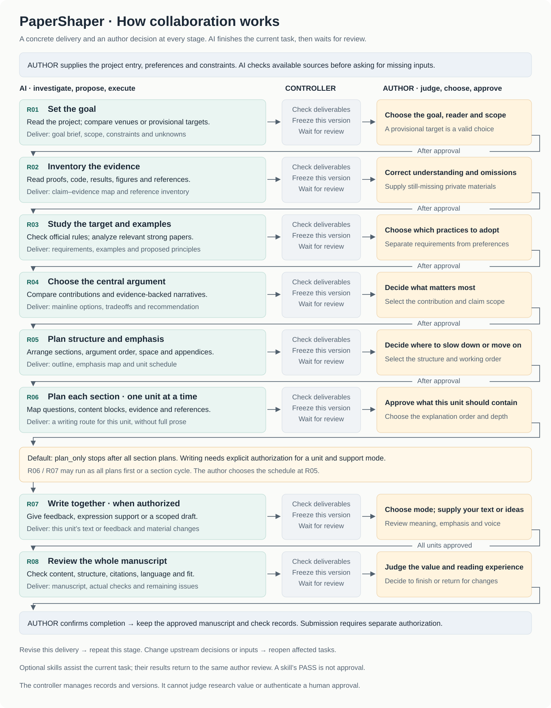
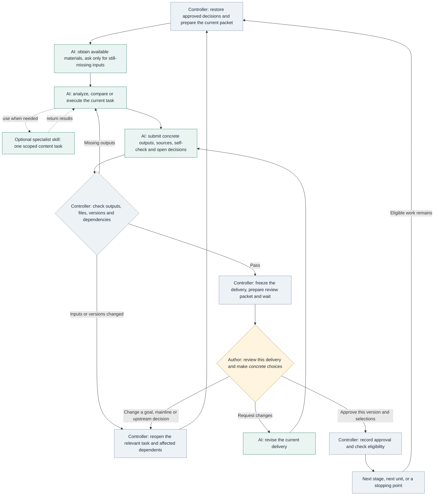
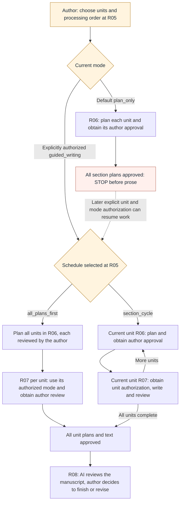

# How the author and AI work together

[Back to the README](../README.md) · [中文](workflow.zh-CN.md)

**AI prepares the materials, options and execution results. The author controls value, structure, emphasis and final expression. Each stage produces a concrete delivery and waits for the author's decision.** The controller keeps the records and checks the sequence, so neither side has to remember every step.

## The complete workflow

The overview shows the handoff at each stage. R01–R05 establish the direction. R06/R07 repeat according to the unit schedule chosen at R05. R08 follows approval of every authorized writing unit. A stage may need several revisions: **eight stages do not mean eight chat messages**.

## Inputs, deliveries and decisions at every stage

AI first checks the supplied project and accessible sources. The author provides still-missing information, preferences and decisions. Each approval refers to a specific delivery version.

| Stage | What the author provides | What AI acquires and does | Concrete delivery | What the author must decide |
| --- | --- | --- | --- | --- |
| **R01 Set the goal** | Project entry, unavailable constraints and target preferences; the target may be undecided | Read the project and existing results; compare journals, conferences or provisional categories, checking year, track and article type | **Goal brief:** purpose, reader, target or provisional category, scope, constraints, unknowns and when to revisit them | Choose the goal, audience and scope; acknowledge the limits of a provisional target |
| **R02 Inventory the evidence** | Still-missing private materials, authoritative versions where sources conflict, corrections to AI's understanding | Read definitions, proofs, implementation, inputs/outputs, results, figures and references; separate proved, finite-instance, empirical, conditional and unresolved claims | **Evidence map and reference inventory:** result IDs and claim–evidence–implementation–figure–source links, actual checks and gaps | Confirm that the research is understood accurately, without omissions or overclaims; assess unresolved gaps |
| **R03 Study the target and examples** | Unavailable internal requirements and preferences about exemplar practices | Check current official rules; analyze a few complementary relevant papers and their argument, results, figures and technical organization | **Requirements, exemplar analysis and proposed principles:** dated sources, transferable practices and relevant differences; distinguish rules, observations and AI advice | Choose which practices and principles to adopt; preferences cannot waive official requirements |
| **R04 Choose the central argument** | Judgments about value, the core problem, main example and scope | Compare evidence-backed narratives, reader relevance, the precise advance over prior work, emphasis, tradeoffs and gaps | **Mainline options and recommendation:** question, claims, evidence IDs and comparison; do not invent alternatives when only one is supported | Select the central contribution, argument, example and claim scope; AI may recommend, the author chooses |
| **R05 Plan structure and emphasis** | Choices about pacing, main text/appendix, space and unit order | Define each section's question, role, entry/exit understanding, claims and evidence; check coverage, repetition and space | **Outline, emphasis map and unit plan:** expand, explain, summarize, append or omit, with reasons; units and processing order | Choose the structure, where to slow down or move quickly, and all plans first versus a section cycle |
| **R06 Plan each section** | Judgment about this unit's content, order and depth; optional spoken ideas, examples or expression preferences | Read only this unit's necessary definitions, results, proofs, implementation, figures and references; order the content blocks | **This unit's writing route:** questions, required content, explanation order, evidence/citations, terms, figure roles, expansion/compression prompts and gaps; no full section prose | Approve what belongs here, the explanation order and depth; approval binds only this version of this unit |
| **R07 Write together, when authorized** | An explicit unit and support mode; text or spoken material for author-writing feedback | Use the approved section plan and adjacent text; give feedback, expression support or a scoped draft; identify material changes | **This unit's text or feedback**, preserving the approved contribution, structure, emphasis and scientific conditions | Review meaning, depth, voice and wording; the author decides the final expression |
| **R08 Review the manuscript** | Judgment about overall value, emphasis, reading experience and completion | Check content, structure, citations, language and target fit; report actual coverage and unchecked items; perform applicable format/render checks | **Manuscript and check results:** actual checks, remaining issues and where to return | Decide to finish or revise; completion does not authorize submission |

## The same review loop at every stage

The review packet contains **the actual work, supporting sources, changes/gaps and decisions to make**. A revision is submitted as a new delivery; approval of an earlier version does not transfer to it. General praise for several alternatives is not a selection. AI self-checks and another skill's PASS are not author approval. If upstream choices must change, the author decides and `reopen` handles the affected tasks; the controller cannot infer every semantic consequence of an arbitrary content change.

## Work one part at a time

The R05 `unit_plan` names the units and their order. A unit can be a section or another explicit scope. There is no sentence-by-sentence requirement, and the support mode can differ between units.

In `plan_only`, all section plans are completed before stopping, regardless of the selected schedule. Writing requires `authorize` to record a real authorization naming the units and support modes; the controller checks this when a unit's R07 starts. If only some units are authorized, work waits at an unauthorized unit. Permission does not expand to the rest of the manuscript.

## Where specialist skills fit

Search, paper reading, citation verification, writing, figures, review and document output are optional capabilities. Give the selected skill **the current goal, necessary materials and one defined output**. Bring its result into the current delivery and use the same author review. The framework does not automatically run an external skill's full pipeline or let it change approved goals or bypass review. A specialist can recommend returning to an earlier decision; the author makes that choice.

The controller checks records, versions and process constraints. It cannot authenticate human identity or establish research value or scientific correctness. This page and its diagrams are reader-facing documentation. Stage contracts live in [`config/stages.json`](../config/stages.json); ordering and state checks are implemented by [`scripts/framework.py`](../scripts/framework.py) and [`scripts/workflow_state.py`](../scripts/workflow_state.py). A working agent loads only the current stage's needed materials, not this entire guide at every step.
