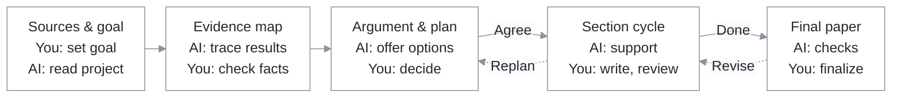

# How the author and AI work together

[Back to the README](../README.md) · [中文](workflow.zh-CN.md)

**AI turns complex materials into work you can assess and use. The author decides what matters, how the argument unfolds, where to spend the reader's attention and how to express it. Review concrete work at each step, then move forward.** The controller saves progress, sources and decisions so the work is easy to resume.

## From project materials to the final manuscript

Review each delivery, carry your decisions forward, and return to the relevant step for revisions. Start with the argument and outline, then choose support for each unit: feedback on your own writing, expression support, or an AI draft you authorize.

## Inputs, deliveries and decisions at every stage

AI first checks the supplied project and accessible sources. The author provides still-missing information, preferences and decisions. Each approval refers to a specific delivery version.

| Stage | What the author provides | What AI acquires and does | Concrete delivery | What the author decides |
| --- | --- | --- | --- | --- |
| **R01 Set the goal** | Project entry, unavailable constraints and target preferences; the target may be undecided | Read the project and existing results; compare journals, conferences or provisional categories, checking year, track and article type | **Goal brief:** purpose, reader, target or provisional category, scope, constraints, unknowns and when to revisit them | Choose the goal, audience and scope; set a time to revisit a provisional target |
| **R02 Inventory the evidence** | Still-missing private materials, authoritative versions where sources conflict, corrections to AI's understanding | Read definitions, proofs, implementation, inputs/outputs, results, figures and references; separate proved, finite-instance, empirical, conditional and unresolved claims | **Project brief, evidence map and reference inventory:** results, reasoning chain, checks and gaps; source index, candidate dispositions and relationship records for program checks | Confirm that the research is understood accurately, without omissions or overclaims; assess unresolved gaps |
| **R03 Study the target and examples** | Unavailable internal requirements and preferences about exemplar practices | Check current official rules; analyze a few complementary relevant papers and their argument, results, figures and technical organization | **Requirements, exemplar analysis and proposed principles:** dated sources, transferable practices and relevant differences; distinguish rules, observations and AI advice | Choose which practices and principles to adopt; confirm the applicable official requirements |
| **R04 Choose the central argument** | Judgments about value, the core problem, main example and scope | Compare evidence-backed narratives, reader relevance, the precise advance over prior work, emphasis, tradeoffs and gaps | **Mainline options and recommendation:** question, claims, result/step IDs and comparison; offer the options that the evidence supports | Select the central contribution, argument, example and claim scope; AI may recommend, the author chooses |
| **R05 Plan structure and emphasis** | Choices about pacing, main text/appendix, space and unit order | Define each section's question, role, entry/exit understanding, claims and evidence; check coverage, repetition and space | **Outline, emphasis map and unit plan:** expand, explain, summarize, append or omit, with reasons; units and processing order | Choose the structure, where to slow down or move quickly, and all plans first versus a section cycle |
| **R06 Plan each section** | Judgment about this unit's content, order and depth; optional spoken ideas, examples or expression preferences | Read only this unit's necessary definitions, results, proofs, implementation, figures and references; order the content blocks | **This unit's writing route:** questions, required content, explanation order, evidence/citations, terms, figure roles, expansion/compression prompts and gaps, ready to guide the author’s writing | Approve what belongs here, the explanation order and depth; approval binds only this version of this unit |
| **R07 Write together, when authorized** | An explicit unit and support mode; text or spoken material for author-writing feedback | Use the approved section plan and adjacent text; give feedback, expression support or a scoped draft; identify material changes | **This unit's text or feedback**, preserving the approved contribution, structure, emphasis and scientific conditions | Review meaning, depth, voice and wording; the author decides the final expression |
| **R08 Review the manuscript** | Judgment about overall value, emphasis, reading experience and completion | Check content, structure, citations, language and target fit; report actual coverage and unchecked items; perform applicable format/render checks | **Manuscript and check results:** actual checks, remaining issues and where to return | Decide to finish or revise, then arrange submission |

## The same review loop at every stage

Each review packet contains **the actual work, supporting sources, changes and open items, and decisions to make**. The author selects an option or requests changes to that version. Revisions return as a new delivery for review. When upstream choices need to change, the author confirms the change and its scope, then `reopen` brings the affected work back into the process.

## Work one part at a time

The R05 `unit_plan` names the units and their order. A unit can be a section or another explicit scope. Choose a working pace and support mode that suits each unit.

The default `plan_only` mode delivers all section plans. When ready to write together, the author chooses units and support modes and records explicit authorization with `authorize`. The controller advances through that agreed scope and keeps the remaining units available for a later decision.

## Where specialist skills fit

Search, paper reading, citation verification, writing, figures, review and document output are optional capabilities. Give the selected skill **the current goal, necessary materials and one defined output**. Bring its result into the current delivery and use the same author review. Each specialist works toward the approved goal and returns the requested result. If it identifies a reason to revisit an earlier decision, it brings that recommendation to the author.

The controller maintains records, versions and workflow order; the author reviews the research and expression. This page and its diagrams explain the collaboration. Stage contracts live in [`config/stages.json`](../config/stages.json); ordering and state checks are implemented by [`scripts/framework.py`](../scripts/framework.py) and [`scripts/workflow_state.py`](../scripts/workflow_state.py). During use, the agent loads the materials needed for the current stage to keep context focused.
