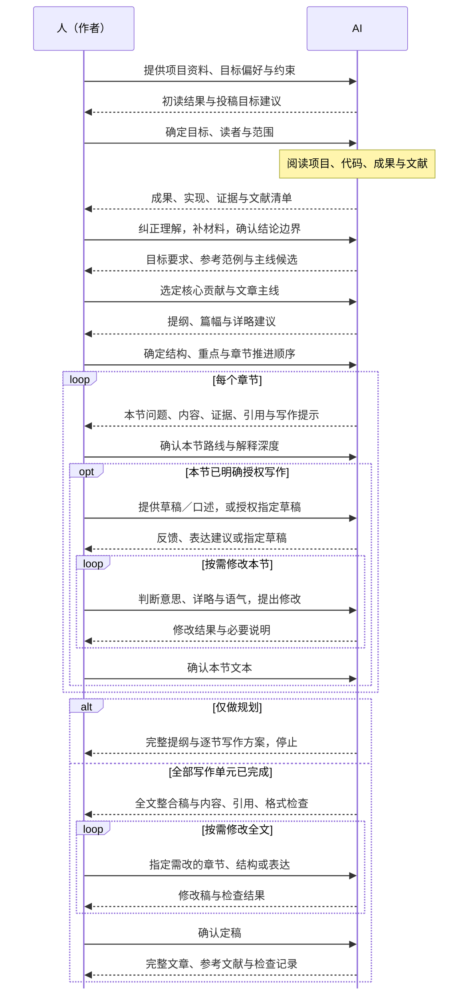

# 人与 AI 如何协同

[返回首页](../README.zh-CN.md) · [English](workflow.md)

**AI 把材料、选项和执行结果准备好；人掌握价值、结构、详略与最终表达。每轮都交付可复核的成果，人明确同意后才进入下一步。** 程序负责记录和流程约束，让双方不必靠记忆维持顺序。

## 从项目资料到文章定稿

上图展示资料进入、逐步决策、章节修改与定稿的路径。下表将它落实到八个阶段：R01–R05 依次确定方向；R06/R07 按 R05 选定的章节节奏重复；R08 在全部授权写作单元通过后进行。每个阶段可以有多轮修改，**“八轮”不是八次对话**。

## 每轮的输入、交付与人的决定

AI 先从已提供的项目与可访问来源获取材料，只向人索取仍缺的信息、偏好和决策。下表中的人审必须对应本轮的具体交付版本。

| 阶段 | 人提供什么 | AI 获取和处理什么 | 本轮具体交付 | 人必须判断／决定什么 |
| --- | --- | --- | --- | --- |
| **R01 明确目标** | 项目入口、不可自行获得的硬约束、目标偏好；也可以说目标未定 | 初读项目和已有结果；比较期刊、会议或暂定类别，核对适用年份、track 与文章类型 | **目标简报**：文章要达到的目的、读者、投稿目标或暂定类别、范围、约束、未知项与回补时点 | 选定目标、读者与范围；接受暂定目标时，同时确认其限制 |
| **R02 成果与证据** | 补充查找后仍缺的私有材料，指定冲突材料的权威版本，纠正研究理解 | 读取定义、证明、实现、输入输出、结果、图表和文献；区分已证、有限实例、实验、条件结论与待证事项 | **证据地图与参考文献清单**：成果 ID、主张—证据—实现—图表—引用映射、实际检查与缺口 | 研究是否被准确理解，有无遗漏或过度主张；剩余缺口是否影响后续 |
| **R03 目标原则与范例** | 不可访问的内部要求，以及对范例做法的取舍 | 查当前官方要求；分析少量互补同类论文如何组织贡献、结果、关键图表和技术内容 | **目标要求、范例分析、建议原则**：来源与核查日期、可借鉴做法及不适用之处；硬要求、范例归纳、AI 建议分开写 | 选择采用哪些组织原则与范例做法；官方硬要求不能因个人偏好改记为满足 |
| **R04 价值与主线** | 对贡献价值、核心问题、主例和范围的判断 | 基于已确认证据比较主线；说明读者意义、已有工作的准确增量、突出什么、弱化什么及代价 | **主线候选与推荐**：每个方案的核心问题、主张、证据 ID、比较依据和缺口；只有一条有支持时不凑选项 | 明确选定核心贡献、主线、主例与结论范围；AI 可以推荐，选择由人作出 |
| **R05 架构与详略** | 对阅读节奏、正文／附录、篇幅和章节处理顺序的选择 | 将主线落实为各节的问题、作用、入口／出口理解、主张与证据；检查覆盖、重复和预算 | **提纲、详略分配与单元计划**：重点展开／正常解释／简述／附录／不纳入，以及理由；章节列表与处理顺序 | 决定先讲什么、哪里展开、哪里快速带过；选择“全部先规划”或“逐节规划后写作” |
| **R06 逐节规划** | 对当前单元内容、顺序和深度的判断；可选口述、例子或表达偏好 | 只读本单元必要的定义、结果、证明、实现、图表与引用，安排内容块及衔接 | **本单元写作路线**：要回答的问题、必含内容、解释顺序、证据／引用、术语与图表作用、展开／压缩提示、缺口；不生成整节正文 | 本节写什么、怎样组织、讲多深；批准仅绑定当前单元的当前版本 |
| **R07 授权后协同写作** | 明确指定单元和方式；人写反馈模式下提供文本或口述 | 使用已批准章节包与相邻文本，按约定做人写反馈、局部表达支持或指定草稿，标出实质修改 | **当前单元文本或反馈**；保留已定贡献、结构、详略与科学条件，不自动扩展到全篇 | 是否准确传达本人意思，详略、语气、措辞是否合适；人决定最终表达 |
| **R08 全文复核** | 对整体价值、重心、阅读效果以及是否完成的判断 | 核内容、结构、引用、语言与目标适配；记录实际覆盖和未检查项，执行任务实际需要的格式／渲染检查 | **完整稿与检查结果**：已检查内容、剩余问题及需回退的位置 | 决定完成或继续修改；完成复核不自动授权投稿 |

## 每一轮都经过同一个交接循环

人收到的是**具体成果、依据、差异／缺口、需要选择的事项**。修改后重新提交新版本，不能沿用旧版同意。对多个方案的笼统肯定不能代替具体选择；AI 自查或外接 skill 的 PASS 也不构成人的批准。需要改变上游取舍时，先由人决定，再用 `reopen` 处理受影响任务；程序不会自动推断任意内容变化的全部影响。

## 一部分一部分地推进

R05 的 `unit_plan` 确定单元列表与顺序，不要求一句一句写。单元可以是一节或其他明确范围，写作方式也可以按单元选择。

在 `plan_only` 下，无论 R05 选择哪种节奏，都先完成所有章节规划并停止。协同写作需要用 `authorize` 记录真实、明确到单元及支持方式的授权；程序在启动该单元 R07 时检查。若中途仅授权一部分单元，到未授权单元会等待，不自动取得其余单元的写作许可。

## 专业 skill 如何接入

检索、论文精读、引用核查、写作、绘图、审稿和文档输出都是可选能力。每次只交给选中 skill **当前目标、必要材料、一个明确输出**，再把成果纳入当前轮交付；由当前轮统一交人复核。框架不自动执行外部 skill 的整套流程，也不让它改写已确认目标或跳过人审。发现内容问题可提出回退建议，最终取舍仍由人决定。

程序负责流程、版本与记录一致性，不能认证人类身份、研究价值或学术结论。图和本页是面向人的使用说明；实际阶段契约以 [`config/stages.json`](../config/stages.json) 为准，实际顺序与状态检查由 [`scripts/framework.py`](../scripts/framework.py) 和 [`scripts/workflow_state.py`](../scripts/workflow_state.py) 实现。使用 skill 时只加载当前轮所需材料，不必把整页流程装入每轮上下文。
